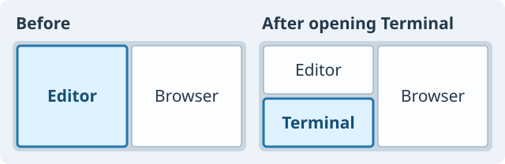
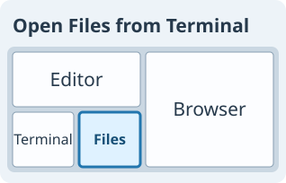
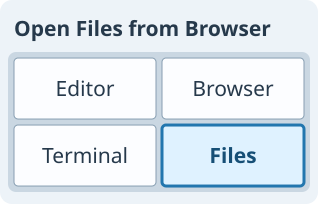

#  Rustile — a lightweight tiling window manager for Windows

Rustile is a **free, open-source window manager** that tiles windows automatically and keeps a separate layout for each virtual desktop. Control windows with configurable keyboard shortcuts, the mouse or the built-in CLI. Tiling and default shortcuts work from the first launch.

[Get Rustile](#get-rustile-for-windows) · [See how tiling works](#how-bsp-tiling-follows-your-focus) · [Keyboard shortcuts](#default-keyboard-shortcuts) · [CLI commands](#control-your-windows-from-powershell)

## Get Rustile for Windows

1. Download [**rustile.exe for Windows x64**](https://github.com/CKATEPTb/rustile/releases/latest/download/rustile.exe) from the [latest release](https://github.com/CKATEPTb/rustile/releases/latest).
2. Run `rustile.exe`.

Rustile arranges the windows already open on your primary monitor. Its icon appears in the system tray, where you can pause tiling, change a shortcut or set it to start at sign-in. To update, run the executable from a newer release. Your preferences carry over.

**Interface languages** — English, Russian, German, French, Italian, Spanish, Simplified Chinese, Japanese, Brazilian Portuguese, Korean, Polish and Turkish.

## How BSP tiling follows your focus

Rustile uses **binary space partitioning (BSP)**. Each new window splits the previously focused tile in two. The splits alternate between horizontal and vertical within each branch. When you close a tiled window, its neighbors reclaim the space.



**Same three windows, different focus.** The highlighted tile is the newly opened window.

<p>
  
  
</p>

Rustile tiles windows within the work area reported by Windows, leaving room for the taskbar and any desktop panel that reserves space. It respects each app’s minimum size. Dialogs open over their parent windows, and fullscreen apps keep control of the screen.

**Move a window.** Drag its title bar over another tile and an outline shows where it will land. Drop near an edge to split the tile on that side, or in the center to exchange positions. With `Win+Shift` + `←/→/↑/↓`, the first press shares space with the neighbor if both windows fit. A second press in the same direction takes the neighbor’s original tile.

**Resize a window.** Drag a shared border and the neighboring windows resize with it. For keyboard control, press `Win+Enter`, then `←`, `→`, `↑` or `↓`. Hold `Shift` to move the same divider back. At a screen edge, Rustile adjusts the opposite shared border. Each step takes effect immediately. `Enter` or `Esc` exits resize mode.

## Default keyboard shortcuts

`Win` with a direction changes focus. Add `Shift` to move the window or `Ctrl` to switch desktops.

| What you want to do | Keys |
| --- | --- |
| Focus a neighboring window | `Win` + `←/→/↑/↓` |
| Move the active window | `Win+Shift` + `←/→/↑/↓` |
| Resize in one step | `Win+Alt` + `←/→/↑/↓`. Add `Shift` to reverse |
| Enter resize mode | `Win+Enter` |
| Maximize or restore a window | `Win+F` |
| Close the active window | `Win+Q` |
| Pause or resume automatic tiling | `Win+Y` |
| Switch to the previous or next desktop | `Win+Ctrl+←` / `Win+Ctrl+→`, or `Win` + wheel ↑ / ↓ |
| Take a window to the previous or next desktop | `Win+Ctrl+Shift+←` / `Win+Ctrl+Shift+→` |
| Jump to a numbered desktop | `Win+1` … `Win+9`, `Win+0` for desktop 10 |
| Take a window to a numbered desktop | `Win+Shift+1` … `Win+Shift+9`, `Win+Shift+0` for desktop 10 |

In the desktop shortcuts, `↑` also goes back and `↓` goes forward. If you pause tiling to arrange windows by hand, you can still switch desktops, close windows and maximize them.

## Windows virtual desktops

Switch desktops with `Win+Ctrl+←/→` or jump directly with `Win+1…0`. Both shortcuts switch without the Windows slide animation. Each desktop retains its window positions and tile sizes when you switch away. Transferring a window also switches to its destination desktop. Desktop numbers follow the order in Task View.

A lone window stays put when you try to move it left from the first desktop or right from the last occupied desktop. You can still send it to a specific desktop by number.

Rustile keeps a spare empty desktop at the end of Task View. Open a window there and the next empty desktop appears. A desktop with minimized windows still counts as occupied. If automatic desktop management is unavailable on your system, you can switch desktops with `Win+Tab`.

## Control your windows from PowerShell

The same `rustile.exe` that runs in the tray provides the CLI. Installation adds `rustile` to `PATH`. Window commands act on the focused window by default.

Run `rustile help` for the command list or `rustile help resize` for help with a specific command.

| Command | Accepted arguments | Action |
| --- | --- | --- |
| `rustile focus` | None | Print the focused window’s title. |
| `rustile focus <direction>` | `left`, `right`, `up`, `down` | Focus the neighboring tile in that direction. |
| `rustile move <direction>` | `left`, `right`, `up`, `down` | Move the focused tile in that direction. |
| `rustile resize <edge> <direction>` | For `left` or `right` edges, use `left` or `right`. For `top` or `bottom` edges, use `up` or `down`. | Move the specified edge one step. |
| `rustile desktop` | None | Print the current desktop number. |
| `rustile desktop <target>` | `next`, `previous`, or a number starting at `1` | Switch desktops. |
| `rustile transfer <target>` | `next`, `previous`, or a number starting at `1` | Move the focused window to that desktop and follow it. |

For example, `rustile resize left right` moves the left edge to the right, narrowing the tile. `rustile resize bottom down` moves the bottom edge down, making the tile taller. The edge names `up` and `down` are aliases for `top` and `bottom`.

`rustile enable`, `rustile disable` and `rustile toggle` control tiling. `rustile maximize` and `rustile close` also work while tiling is paused.

## Build from source

With the Rust MSVC toolchain and Windows SDK installed, build the same LZX-compressed download as the GitHub release.

```powershell
.\scripts\package-release.ps1
```

The result is `target\dist\rustile.exe`. It unpacks Rustile during installation. For a regular development build without packaging, run `cargo build --release`.

To change the release version, edit [VERSION](VERSION) and run `.\scripts\sync-version.ps1` to regenerate the Cargo package versions and lockfiles.

## License

Rustile is free to use, modify and redistribute under the [MIT License](LICENSE).
